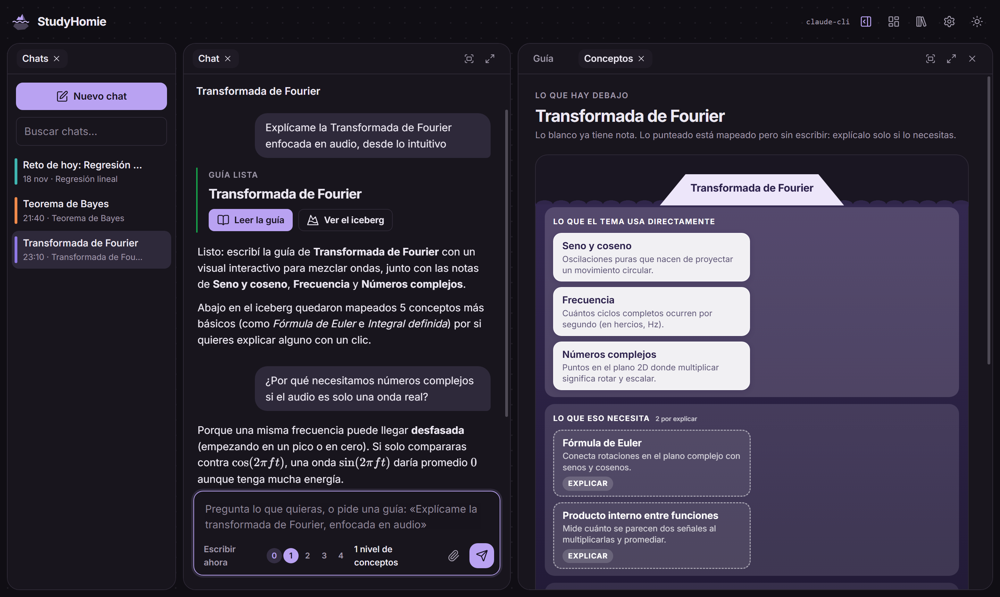

# StudyHomie

**Aprende con intuición y comprueba que puedes explicarlo.**
Un asistente de estudio con IA que corre en tu computadora: un programa de consola con una interfaz web local, y tus notas en un vault de Markdown compatible con Obsidian.

Le pides un tema y escribe una guía de estudio con visuales interactivos, mapea todo lo que ese tema da por sabido hasta lo básico (un «iceberg» de conceptos) y te hace practicar: preguntas que piden razonar y explicarlo con tus palabras. Funciona con la IA que ya tengas: Claude Code, Codex, Antigravity, cualquier API conocida o un modelo local.


## Instálalo con tu agente de IA

La forma más rápida: abre tu agente de programación (Claude Code, Codex, Cursor, Antigravity…) en una terminal y pégale esto:

```
Instala StudyHomie (https://github.com/krilinxito/studyhomie) siguiendo la sección
«Instalación paso a paso» de su README, configúralo con la IA que yo ya tenga lista
y comprueba que funciona con `studyhomie check --live`.
```

La sección siguiente está escrita para que un agente (o tú) la siga en orden, solo con la consola.

## Instalación paso a paso

> **Para agentes de IA:** sigue los pasos en orden. Cada uno dice cómo comprobar que salió bien.
> - Nunca pidas, escribas ni guardes claves de API en archivos o en el chat: van en variables de entorno que define la persona.
> - Los inicios de sesión de los CLI (`claude`, `codex login`, `agy`) son interactivos y los hace la persona: si hacen falta, dile el comando exacto y espera.
> - El paso 4 termina con `studyhomie check --live`, que sale con código 0 si todo funciona y con 1 si no (y dice por qué).

### 1. Instala el programa

Elige **una** opción.

**A. Con Go** (si `go version` muestra 1.24 o más):

```sh
go install github.com/krilinxito/studyhomie/cmd/studyhomie@latest
```

El binario queda en `$(go env GOPATH)/bin` (en Windows, `%USERPROFILE%\go\bin`). Si `studyhomie` no se encuentra después, agrega esa carpeta al `PATH`.

**B. Binario listo, sin Go.** Windows (PowerShell):

```powershell
$v = (Invoke-RestMethod https://api.github.com/repos/krilinxito/studyhomie/releases/latest).tag_name
$name = "studyhomie_${v}_windows_amd64"
Invoke-WebRequest "https://github.com/krilinxito/studyhomie/releases/download/$v/$name.zip" -OutFile "$env:TEMP\studyhomie.zip"
Expand-Archive "$env:TEMP\studyhomie.zip" -DestinationPath "$env:LOCALAPPDATA\studyhomie" -Force
$dir = "$env:LOCALAPPDATA\studyhomie\$name"
$userPath = [Environment]::GetEnvironmentVariable('Path', 'User')
if ($userPath -notlike "*$dir*") { [Environment]::SetEnvironmentVariable('Path', "$userPath;$dir", 'User') }
$env:Path += ";$dir"   # para esta misma terminal
```

macOS y Linux:

```sh
v=$(curl -fsSL https://api.github.com/repos/krilinxito/studyhomie/releases/latest | grep -m1 '"tag_name"' | cut -d'"' -f4)
os=$(uname -s | tr '[:upper:]' '[:lower:]')
arch=$(uname -m); case "$arch" in x86_64) arch=amd64 ;; aarch64|arm64) arch=arm64 ;; esac
curl -fsSL "https://github.com/krilinxito/studyhomie/releases/download/$v/studyhomie_${v}_${os}_${arch}.tar.gz" | tar -xz -C /tmp
mkdir -p ~/.local/bin && mv "/tmp/studyhomie_${v}_${os}_${arch}/studyhomie" ~/.local/bin/
# si ~/.local/bin no está en el PATH: export PATH="$HOME/.local/bin:$PATH"  (y agrégalo a ~/.bashrc o ~/.zshrc)
```

**C. Desde el código** (Go 1.24+):

```sh
git clone https://github.com/krilinxito/studyhomie
cd studyhomie
go build -o studyhomie ./cmd/studyhomie     # en Windows: -o studyhomie.exe
```

**Comprueba:** `studyhomie version` imprime la versión.

### 2. Crea la carpeta de estudio

StudyHomie guarda su configuración (`studyhomie.toml`) y tu vault en la carpeta desde donde lo ejecutas. Crea una y entra en ella:

```sh
mkdir estudios
cd estudios
```

### 3. Elige la IA

Mira qué IAs puede usar ya esta computadora:

```sh
studyhomie check
```

Lista todas las opciones con su estado (`lista`, `no instalado`, `falta OPENAI_API_KEY`, `no responde`…). Elige la primera que salga **lista**, en este orden de preferencia:

1. `claude-cli`: Claude Code con el plan de Claude. Es la que más se probó.
2. `codex`: Codex CLI con la cuenta de ChatGPT.
3. Una API con clave ya definida: `anthropic-api`, `openai`, `gemini`, `openrouter`…
4. `ollama` o `lmstudio`: un modelo local.
5. `agy`: Antigravity CLI. Es experimental.

Y crea la configuración con ella (sin preguntas):

```sh
studyhomie init --provider claude-cli
```

Más ejemplos:

```sh
studyhomie init --provider codex
studyhomie init --provider openai --model gpt-5.2
studyhomie init --provider gemini --model gemini-3-flash
studyhomie init --provider ollama --model qwen3:14b
studyhomie init --provider openai-compatible --base-url http://localhost:8000/v1 --model mi-modelo
```

Salvo los CLI y `anthropic-api`, las IAs necesitan `--model`. Para ver los modelos disponibles, abre Ajustes en la interfaz (paso 5).

Si **ninguna** está lista, la persona tiene que preparar una. Dale el comando de su caso:

| Quiere usar | Qué hace la persona |
|---|---|
| Claude Code (su plan de Claude) | Windows: `irm https://claude.ai/install.ps1 \| iex`; macOS/Linux: `curl -fsSL https://claude.ai/install.sh \| bash`. Luego ejecuta `claude` una vez para iniciar sesión |
| Codex (su cuenta de ChatGPT) | `npm install -g @openai/codex` y `codex login` |
| Una API | Define la clave en una variable de entorno (ver [Elegir la IA](#elegir-la-ia)) y abre una terminal nueva |
| Un modelo local | Instala [Ollama](https://ollama.com), ejecuta `ollama pull qwen3:14b` y deja Ollama abierto |

`init` se puede repetir: sobre un archivo que ya existe, cambia solo los valores que le pases.

### 4. Comprueba que funciona

```sh
studyhomie check --live
```

Le manda un mensaje de prueba a la IA elegida. Si responde, imprime `Funciona: … respondió "listo" en N s` y sale con código 0. Si no, explica qué falta y sale con 1.

### 5. Úsalo

```sh
studyhomie
```

Abre la interfaz en <http://127.0.0.1:8765>. `Ctrl+C` en la terminal la cierra. Para dejarla corriendo sin abrir el navegador (por ejemplo, si la lanza un agente): `studyhomie serve --no-open`.

## Uso desde la consola

Todo lo importante se puede hacer sin la interfaz web. Los comandos trabajan sobre el vault de la carpeta actual.

| Comando | Qué hace |
|---|---|
| `studyhomie` / `studyhomie serve [--port N] [--no-open]` | La interfaz web local |
| `studyhomie init [--provider P] [--model M] [--quick-model M] [--base-url URL] [--vault DIR] [--port N]` | Crea o cambia `studyhomie.toml` y el vault |
| `studyhomie check [--live]` | Configuración, vault y qué IAs están listas; `--live` las prueba |
| `studyhomie guide "tema" [--depth N] [--foco "..."]` | Guía + notas de concepto. `--depth` (0 a 4) es cuántos niveles de prerrequisitos se escriben ya; lo demás queda mapeado para explicar después |
| `studyhomie study "tema"` | Ciclo completo: guía, preguntas y explicarlo con tus palabras |
| `studyhomie prepare "tema"` | Solo la guía |
| `studyhomie quiz <tema> [n] [dificultad]` | Preguntas de razonamiento sobre una guía |
| `studyhomie feynman <tema>` | Lo explicas tú y te señala los huecos |
| `studyhomie doubt <tema> "pregunta"` | Responde una duda y la guarda en la guía |
| `studyhomie extend <tema>` | Agrega los conceptos base que la guía da por sabidos |
| `studyhomie interactive <tema>` | Genera una simulación interactiva (HTML) |
| `studyhomie roadmap "materia"` | Traza el grafo de temas de una materia entera |
| `studyhomie material apuntes.pdf ...` | Roadmap a partir de tus apuntes (txt, md, pdf, pptx, docx, imágenes) |
| `studyhomie next <roadmap>` | El siguiente tema cuyos prerrequisitos ya dominas |
| `studyhomie daily [campo\|todos]` | El reto del día, de tus campos de interés o del que digas |
| `studyhomie graph` | Temas y conexiones del vault, en texto |
| `studyhomie help` / `version` | Ayuda y versión |

Los temas se nombran por su slug (`transformada-de-fourier`) o con su título entre comillas.

Algunos comandos preguntan cosas por la consola: aprobar el plan de conceptos, aceptar el reto del día, responder un quiz. Las respuestas se leen de la entrada estándar, así que también se pueden pasar por tubería:

```sh
echo s | studyhomie guide "Transformada de Fourier" --depth 1 --foco "audio"   # aprueba el plan tal cual
echo g | studyhomie guide "Teorema de Bayes"                                   # solo la guía, sin notas
```

En el plan, `s` (o Enter) lo aprueba, `g` escribe solo la guía, `n` cancela, y se puede editar: `-id` quita un concepto, `+Título` agrega uno y `*id` escribe ya uno de los de abajo.

## Qué hace

- **Un iceberg de conceptos.** Cada guía mapea todo lo que da por sabido, nivel por nivel, hasta lo básico. Mapear es barato: solo títulos y una frase. «Escribir ahora» (0 a 4) decide cuántos niveles se escriben de entrada como notas; lo de más abajo queda en gris y se escribe con un clic en **Explicar** solo si lo necesitas.
- **Nada se da por sabido en silencio.** La guía enlaza cada término que asume. Si ese concepto aún no tiene nota, el enlace sale en gris con «explicar».
- **Plan editable.** Antes de escribir te muestra el árbol: desmarcas lo que ya sabes, agregas lo que falte, y decides si escribe guía y notas, solo la guía, o nada.
- **Intuición sin plantillas.** Nada de «imagina que tienes…». Las guías arrancan con un problema concreto con números, reinventan la idea (el intento ingenuo, por qué falla y el arreglo), la llevan a los casos extremos y dejan la fórmula para el final.
- **Visuales para mover, al estilo 3Blue1Brown.** Funciones con sliders, una matriz que deforma el plano, procesos paso a paso, experimentos aleatorios repetidos mil veces y preguntas de «predice antes de seguir leyendo».
- **Practicar.** Preguntas de razonamiento, explicar con tus palabras (método Feynman) y tarjetas de repaso.
- **Recursos verificados.** Videos, webs, libros y papers con su enlace; los enlaces se comprueban antes de guardarlos (con las IAs que buscan en la web).

## La interfaz web

Minimal, sobre un fondo de puntos, en claro u oscuro. Todo son paneles acoplables: arrastra una pestaña para dividir la pantalla o apilarla, y el layout se recuerda.

- **Chats y Chat.** Preguntas, pides guías, quizzes, el reto del día (con la temática que quieras) o una nota de concepto. Puedes adjuntar imágenes y archivos a un mensaje y la IA los mira con tu pregunta. Los chats se guardan y se pueden continuar.
- **El panel de estudio** entra desde la derecha cuando hay algo que mostrar, y se puede ampliar, poner en pantalla completa o cerrar:
  - **Guía**: el artículo con sus visuales.
  - **Conceptos**: el iceberg; lo de abajo se explica con un clic.
  - **Mapa**: guías y conceptos conectados, de este chat o de todos.
  - **Practicar**.
  - **Apuntes**: tus propias notas por guía o concepto, con imágenes y archivos pegados.
- **Vault.** Todas las notas, con búsqueda en el texto. Cada una se abre en la app, se edita a mano o se abre en Obsidian. Desde aquí también se crean otros vaults en cualquier carpeta y se cambia entre ellos; cada uno tiene sus guías, chats y mapa.
- **Ajustes.** Eliges la IA y el modelo de una lista, y pruebas la conexión.




## Elegir la IA

Se cambia con `studyhomie init --provider …` o en **Ajustes** dentro de la app; se guarda en `studyhomie.toml`.

**Con tu suscripción (programas de terminal).** StudyHomie solo ejecuta el comando; no lee ni guarda tus credenciales.

| `provider` | Qué usa | Qué necesitas |
|---|---|---|
| `claude-cli` (por defecto) | Claude Code, con tu plan de Claude | Instalarlo y ejecutar `claude` una vez para iniciar sesión |
| `codex` | Codex CLI, con tu cuenta de ChatGPT o una clave de OpenAI | `npm install -g @openai/codex` y `codex login` |
| `agy` (experimental) | Antigravity CLI, con tu cuenta de Google | Ejecutar `agy` una vez para iniciar sesión |

Codex y Antigravity son agentes con herramientas propias: StudyHomie los ejecuta en una carpeta temporal vacía y les pide solo responder, así nunca tocan tus archivos.

**APIs (clave propia, pago por uso).** La clave va siempre en una variable de entorno, nunca en la app ni en archivos.

| `provider` | Variable | Búsqueda web |
|---|---|---|
| `anthropic-api` | `ANTHROPIC_API_KEY` | sí |
| `openai` | `OPENAI_API_KEY` | sí |
| `gemini` | `GEMINI_API_KEY` (o `GOOGLE_API_KEY`) | sí (Google Search) |
| `openrouter` | `OPENROUTER_API_KEY` | sí |
| `groq`, `deepseek`, `mistral`, `xai`, `together` | `GROQ_API_KEY`, `DEEPSEEK_API_KEY`, … | no |
| `openai-compatible` | `OPENAI_COMPAT_API_KEY` (si hace falta) + `--base-url` | no |

**En tu PC.** `ollama` (`http://localhost:11434/v1`) y `lmstudio` (`http://localhost:1234/v1`), sin clave; la URL se cambia con `--base-url`. Los modelos de 14B o más siguen mejor el formato de las guías.

Sin búsqueda web las guías salen sin videos ni webs recomendados; lo demás funciona igual. `quick_model` es opcional: un modelo más rápido para el chat, las notas de concepto y el plan.

Definir una clave (la persona, una vez):

```sh
# Windows (PowerShell); después abre una terminal nueva
setx OPENAI_API_KEY "sk-..."

# macOS / Linux: agrégalo a ~/.bashrc o ~/.zshrc
export OPENAI_API_KEY="sk-..."
```

> Revisa los términos de cada servicio antes de automatizar el uso de su CLI. StudyHomie los ejecuta localmente, con tu sesión, como lo harías tú en la terminal.

## Configuración (`studyhomie.toml`)

Todo es opcional; sin el archivo se usan estos valores. `studyhomie init` lo crea, y sus flags cambian las claves principales.

| Clave | Por defecto | Para qué |
|---|---|---|
| `provider` | `"claude-cli"` | La IA (ver [Elegir la IA](#elegir-la-ia)) |
| `model` | vacío | Modelo; vacío = el del proveedor |
| `quick_model` | vacío | Modelo para respuestas cortas; vacío = `model` |
| `base_url` | vacío | URL de un servidor local o compatible con OpenAI |
| `port` | `8765` | Puerto de la interfaz web |
| `language` | `"español"` | Idioma de guías, pruebas y tutor |
| `vault` | `"vault"` | El vault en uso |
| `vaults` | `[]` | Todos los vaults agregados, para cambiar entre ellos |
| `interests` | lista amplia | Campos de los que sale el reto diario |
| `depth` | `1` | Niveles de conceptos que se escriben de entrada fuera del chat |
| `iceberg` | `true` | Mapear siempre los conceptos hasta lo básico |
| `parallel` | `3` | Notas de concepto que se escriben a la vez |
| `context_window` / `compact_at` | `200000` / `0.6` | Cuándo se resume una conversación larga |

## Tu vault

Las notas son archivos Markdown normales con `[[enlaces]]`: abre la carpeta del vault con [Obsidian](https://obsidian.md) y verás el grafo de lo que aprendiste. Puedes tener varios vaults (uno por materia, o uno en una carpeta sincronizada); quitar uno de la lista nunca borra su carpeta.

```
vault/
  guias/         un .md por tema: guía, recursos, dudas, prueba y Feynman
  conceptos/     un .md por concepto (En una frase, Intuición, Cómo funciona, Ejemplo,
                 Errores comunes, Relacionado); «requiere:» marca los prerrequisitos
  apuntes/       tus apuntes, uno por guía o concepto; nunca se tocan al reescribir una guía
    adjuntos/    las imágenes y archivos pegados en ellos
  roadmaps/      el plan de cada materia
  daily/         un registro por día
  interactive/   simulaciones generadas (HTML)
  .studyhomie/   estado interno: chats guardados, archivos subidos, resúmenes
```

## Privacidad y seguridad

- **Qué se envía al modelo:** el tema, tus mensajes y respuestas, lo que adjuntes y los fragmentos relevantes de tus apuntes. El vault se queda en tu computadora.
- **La interfaz solo escucha en `127.0.0.1`.** Rechaza peticiones con un `Host` que no sea local y exige `Origin` propio en todo lo que modifica algo, así otra página abierta en tu navegador no puede usarla.
- **Las simulaciones las escribe la IA**, así que se sirven aisladas: sin red y sin acceso a la app ni a tus datos. Los archivos adjuntos que no son imágenes se descargan, nunca se ejecutan en la app.

## Desarrollo

```sh
go test ./...
go vet ./...
```

Estructura:

- `cmd/studyhomie`: la entrada de la consola.
- `internal/session`: los flujos (guía, plan, chat, quiz, Feynman, reto del día).
- `internal/provider/*` e `internal/providers`: las IAs, intercambiables.
- `internal/vault`: notas, conceptos, apuntes y búsqueda.
- `internal/web`: el servidor y la interfaz, embebida en el binario.
- `internal/viz`: valida los visuales interactivos.

Para publicar una versión basta con subir una etiqueta (`git tag v0.2.0 && git push --tags`): el workflow compila los binarios de Windows, macOS y Linux y crea la release.

## Licencia

[MIT](LICENSE)
