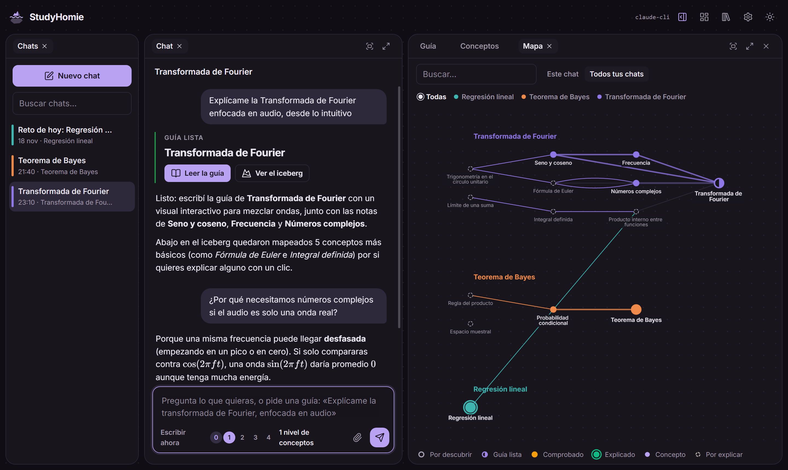

# StudyHomie

**Aprende con intuición y comprueba que puedes explicarlo.**
Un asistente de estudio con IA que corre en tu computadora, con una interfaz web local y un vault de notas Markdown (compatible con Obsidian) que muestra lo que has aprendido y cómo se conecta.



## Qué hace

Todo empieza en un **chat**. Pregunta lo que quieras y te responde ahí mismo; pide que te explique un tema a fondo y escribe una **guía de estudio** con sus **notas de concepto** aparte.

- **Un iceberg de conceptos.** Cada guía mapea todo lo que da por sabido, nivel por nivel, hasta lo básico. Mapear es barato: solo títulos y una frase. Junto al cuadro de texto, **«Escribir ahora»** (0 a 4) decide cuántos niveles se escriben de entrada como notas propias; lo que queda más abajo se ve en gris, «bajo el agua», y se escribe con un clic en **Explicar** solo si lo necesitas. Así sirve para quien llega sin base, sin gastar tokens en lo que ya sabes. También puedes decirlo con tus palabras: «desde lo más básico», «enfocado en audio».
- **Nada se da por sabido en silencio.** La guía enlaza cada término que asume. Si ese concepto aún no tiene nota, el enlace sale en gris con «explicar»: un clic y se escribe.
- **Plan editable.** Antes de escribir nada te muestra el árbol: lo que se escribe ahora y lo que queda bajo el agua. Desmarcas lo que ya sabes (y se va con ello lo que solo dependía de eso), marcas algo de abajo si lo quieres ya, añades lo que falte, y decides: guía y notas, solo la guía, o cancelar. Los conceptos que ya están en tu vault se enlazan, no se reescriben.
- **Intuición sin plantillas.** Nada de «imagina que tienes…». Las guías arrancan con un problema concreto con números, te hacen reinventar la idea (el intento ingenuo, por qué falla y el arreglo), la empujan a los casos extremos, la miran desde otro ángulo y cuentan qué problema tenía quien la inventó. La fórmula llega al final, como conclusión.
- **Visuales para mover, al estilo 3Blue1Brown.** Dentro de la guía hay widgets en vivo: funciones con sliders, una matriz que deforma el plano (con î, ĵ y el determinante como área), procesos paso a paso, experimentos aleatorios que se repiten mil veces y preguntas de «predice antes de seguir leyendo». Si ninguno sirve, la guía propone una página interactiva que se construye cuando la pides.
- **Practicar.** Preguntas que piden razonar y no memorizar, explicar el tema con tus palabras (método Feynman) y tarjetas de repaso hechas con tus notas de concepto.

Desde el chat también puedes pedir el **reto del día** (un tema al azar de tus campos de interés), **planear una materia entera** (un roadmap con prerrequisitos) o **adjuntar tus apuntes** (txt, md, pdf, pptx, docx o imágenes). Los recursos externos (videos, webs, libros, papers) van siempre con su enlace, y los enlaces se comprueban antes de guardarlos.


## Requisitos

- Un navegador.
- **Una** forma de acceder a un modelo de IA (ver [Elegir la IA](#elegir-la-ia)):
  - un programa de terminal con tu suscripción: [Claude Code](https://claude.com/claude-code) (por defecto), Codex CLI o Antigravity CLI, **o**
  - la clave de una API: Anthropic, OpenAI, Gemini, OpenRouter, Groq, DeepSeek, Mistral, xAI…, **o**
  - un modelo local con Ollama o LM Studio.

## Instalación

**Opción A: binario listo (sin instalar nada más).** Descarga el archivo de tu sistema desde [Releases](https://github.com/krilinxito/studyhomie/releases/latest), descomprímelo y deja `studyhomie` (o `studyhomie.exe` en Windows) donde quieras, idealmente en una carpeta que esté en tu `PATH`.

**Opción B: con Go** (1.24 o superior):

```
go install github.com/krilinxito/studyhomie/cmd/studyhomie@latest
```

**Opción C: desde el código:**

```
git clone https://github.com/krilinxito/studyhomie
cd studyhomie
go build -o studyhomie ./cmd/studyhomie
```

## Uso normal

1. **Crea una carpeta para tus estudios** y entra en ella. Ahí vivirá tu vault.

   ```
   mkdir mis-estudios
   cd mis-estudios
   ```

2. **Ejecuta `studyhomie`.** Sin argumentos abre la interfaz web en <http://127.0.0.1:8765> y crea la carpeta `vault/` la primera vez.

   ```
   studyhomie
   ```

3. **Escribe en el chat** lo que quieras entender, elige cuánto escribir ahora y envía. La guía aparece en su panel.

Para parar el programa, `Ctrl+C` en la terminal. Cada carpeta es un vault independiente: puedes tener una por materia, o una sola para todo.

> Si al arrancar ves un aviso rojo, falta configurar la IA (ver la siguiente sección).

## Interfaz

Un estilo minimal sobre un fondo de puntos, en modo claro u oscuro (el botón de sol/luna; por defecto sigue al sistema). Todo son **paneles acoplables**: arrastra una pestaña para dividir la pantalla, apilarla con otras o moverla de lugar, y redimensiona arrastrando los bordes. Tu layout se recuerda; el botón de paneles vuelve a abrir uno que cerraste o **restablece el layout**. En el móvil queda todo en un solo grupo de pestañas.

- **Chats**: tu historial. Los chats se guardan en `vault/.studyhomie/sessions/` y se pueden **continuar**: escribe en uno viejo y sigue donde lo dejaste, con su contexto.
- **Chat**: donde preguntas y pides guías, quizzes, el reto del día o una nota de concepto.
- **Guía**: la guía abierta como artículo, con sus visuales, sus enlaces grises por explicar y sus recursos.
- **Conceptos**: el iceberg de la guía. Arriba del agua el tema; abajo, nivel por nivel, lo que necesita: lo blanco tiene nota, lo punteado se explica al pulsarlo.
- **Mapa**: cada guía con sus conceptos, conectados por lo que requiere cada uno; los pendientes salen en gris.
- **Practicar**: preguntas, explicar con tus palabras, tarjetas de repaso y simulación.

Las guías y notas admiten:

- **Avisos** con la sintaxis de callouts de Obsidian (`> [!info] Definición`, `> [!example]`, `> [!tip]`, `> [!warning]`, `> [!question]`), que también se ven bien en Obsidian.
- **Tablas** y **fórmulas** (`$...$`).
- **Diagramas Mermaid** (` ```mermaid `), dibujados en local; si uno no se puede dibujar, se muestra su código.
- **Recursos en lista**, con tipo y dominio. Los videos de YouTube se reproducen dentro de la nota, pero solo cargan YouTube (`youtube-nocookie.com`) cuando haces clic en reproducir; hasta entonces no hay ninguna petición externa.

## Elegir la IA

Por defecto usa **Claude Code**. Para cambiar, abre **Ajustes** (el engranaje arriba a la derecha): eliges la IA y el modelo, puedes **cargar la lista de modelos** que ofrece y **probar la conexión** antes de guardar. La elección se guarda en `studyhomie.toml` y se aplica al instante; lo que ya esté en curso termina con la IA anterior.

**Con tu suscripción (programas de terminal).** StudyHomie solo ejecuta el comando; no lee ni guarda tus credenciales.

| `provider` | Qué usa | Qué necesitas |
|---|---|---|
| `claude-cli` (por defecto) | Claude Code, con tu plan de Claude | Instalarlo (`irm https://claude.ai/install.ps1 \| iex` en Windows) y ejecutar `claude` una vez para iniciar sesión |
| `codex` | Codex CLI, con tu cuenta de ChatGPT o una clave de OpenAI | `npm install -g @openai/codex` y `codex login` |
| `agy` (experimental) | Antigravity CLI, con tu cuenta de Google | Ejecutar `agy` una vez para iniciar sesión |

Codex y Antigravity son agentes con herramientas propias: StudyHomie los ejecuta en una carpeta temporal vacía y les pide solo responder, así nunca tocan tus archivos.

**APIs (clave propia, pago por uso).** La clave va siempre en una variable de entorno, nunca en la app ni en archivos.

| `provider` | Variable | Búsqueda web |
|---|---|---|
| `anthropic-api` | `ANTHROPIC_API_KEY` | sí |
| `openai` | `OPENAI_API_KEY` | sí |
| `gemini` | `GEMINI_API_KEY` (o `GOOGLE_API_KEY`) | sí (Google Search) |
| `openrouter` | `OPENROUTER_API_KEY` | sí |
| `groq`, `deepseek`, `mistral`, `xai`, `together` | `GROQ_API_KEY`, `DEEPSEEK_API_KEY`, … | no |
| `openai-compatible` | `OPENAI_COMPAT_API_KEY` (si hace falta) + `base_url` | no |

**En tu PC.** `ollama` (`http://localhost:11434/v1`) y `lmstudio` (`http://localhost:1234/v1`), sin clave; la URL se puede cambiar. Con modelos locales, los de 14B o más siguen mejor el formato de las guías.

Sin búsqueda web, las guías salen sin videos ni webs recomendados; todo lo demás funciona igual. Salvo los programas de terminal y la API de Anthropic, hay que elegir un modelo (`model`); `quick_model` es opcional y se usa para el chat, las notas de concepto y el plan.

Definir una clave:

```
# Windows (PowerShell), una vez; abre una terminal nueva después
setx OPENAI_API_KEY "sk-..."

# macOS / Linux
export OPENAI_API_KEY="sk-..."
```

> Revisa los términos de cada servicio antes de automatizar el uso de su CLI. StudyHomie los ejecuta localmente, con tu sesión, como lo harías tú en la terminal.

## Configuración (`studyhomie.toml`)

Todo es opcional; sin el archivo se usan estos valores.

| Clave | Por defecto | Para qué |
|---|---|---|
| `provider` | `"claude-cli"` | La IA: ver [Elegir la IA](#elegir-la-ia) |
| `base_url` | vacío | URL de un servidor local o compatible con OpenAI |
| `model` | vacío | Modelo a usar; vacío = el del proveedor |
| `quick_model` | vacío | Modelo para las respuestas cortas (conceptos base y dudas); vacío = `model`. Poner uno más rápido y barato hace que respondan antes |
| `port` | `8765` | Puerto de la interfaz web |
| `language` | `"español"` | Idioma de guías, pruebas y tutor |
| `vault` | `"vault"` | Carpeta de las notas |
| `interests` | lista amplia | Campos de los que sale el reto diario. "Totalmente aleatorio" suma además los campos por defecto |
| `context_window` / `compact_at` | `200000` / `0.6` | Cuándo se resume una conversación larga para que no se acumule el contexto |
| `depth` | `1` | Niveles de conceptos que se escriben de entrada en las guías hechas fuera del chat (roadmap, reto del día, terminal) |
| `iceberg` | `true` | Mapear siempre los conceptos hasta lo básico, aunque se escriban menos |
| `parallel` | `3` | Notas de concepto que se escriben a la vez |

## Tu vault

Las notas son archivos Markdown normales con `[[enlaces]]`. **Abre la carpeta `vault/` con [Obsidian](https://obsidian.md)** y verás el grafo de lo que has aprendido. Un vault de una versión anterior (con `topics/`) se pasa solo a `guias/` la primera vez que arranca.

```
vault/
  guias/         un .md por tema: guía, recursos, dudas, prueba y Feynman
  conceptos/     un .md por concepto: En una frase, Intuición, Cómo funciona, Ejemplo,
                 Errores comunes, Relacionado y Aparece en; «requiere:» separa los
                 prerrequisitos de los simples enlaces
  roadmaps/      el plan de cada roadmap
  daily/         un registro por día
  interactive/   simulaciones generadas (HTML)
  .studyhomie/   estado interno (resúmenes entre fases, apuntes subidos, sesiones guardadas)
```

## Desde la terminal

Todo lo que hace la interfaz web también se puede hacer sin ella:

```
studyhomie roadmap "Teoría de juegos"     # alcance + grafo de temas
studyhomie material apuntes.pdf           # roadmap desde tus apuntes
studyhomie next teoría-de-juegos          # siguiente tema cuyos prerrequisitos ya dominas
studyhomie daily                          # reto del día (o: daily Física, daily todos)
studyhomie study "Teorema de Bayes"       # preparación → prueba → Feynman
studyhomie guide "Transformada de Fourier" --depth 2 --foco "audio"
studyhomie prepare | quiz | feynman | extend | interactive <tema>
studyhomie doubt <tema> "tu pregunta"     # responde una duda y la guarda en el artículo
studyhomie graph                          # temas y conexiones
studyhomie serve --port 9000 --no-open    # interfaz web en otro puerto, sin abrir el navegador
studyhomie help
```

## Privacidad y seguridad

- **Qué se envía al modelo:** el tema que estudias, tus respuestas y explicaciones, y los fragmentos de tus apuntes que sean relevantes. Tus notas y tu vault se quedan en tu computadora.
- **La interfaz web solo escucha en `127.0.0.1`.** Rechaza peticiones con un `Host` que no sea local y exige `Origin` propio en todo lo que modifica algo, de modo que otra página abierta en tu navegador no puede usarla. La única página externa que puede incrustar es el reproductor de YouTube, y solo después de que pulses reproducir.
- **Las simulaciones las escribe la IA**, así que se sirven aisladas: sin red, sin acceso a la app ni a tus datos, y se rechazan las que intenten cargar recursos externos.

## Desarrollo

```
go test ./...
```

Estructura: `cmd/studyhomie` (entrada), `internal/session` (las tres fases y los flujos), `internal/provider/*` (backends de IA, intercambiables), `internal/vault` (notas y grafo), `internal/web` (servidor e interfaz), `internal/material` (extracción y búsqueda en apuntes), `internal/roadmap` (validación del grafo).

Para publicar una versión basta con subir una etiqueta (`git tag v0.2.0 && git push --tags`): el workflow de GitHub compila los binarios y crea la release.

## Licencia

[MIT](LICENSE)
