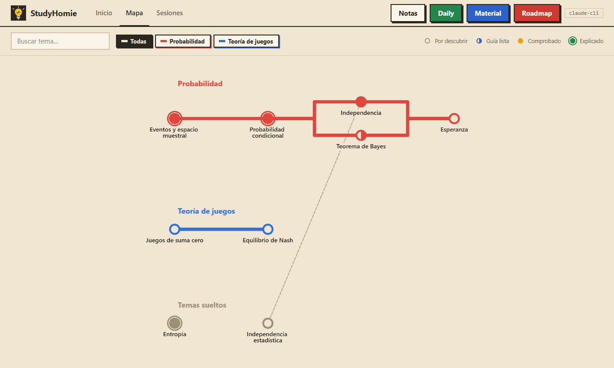
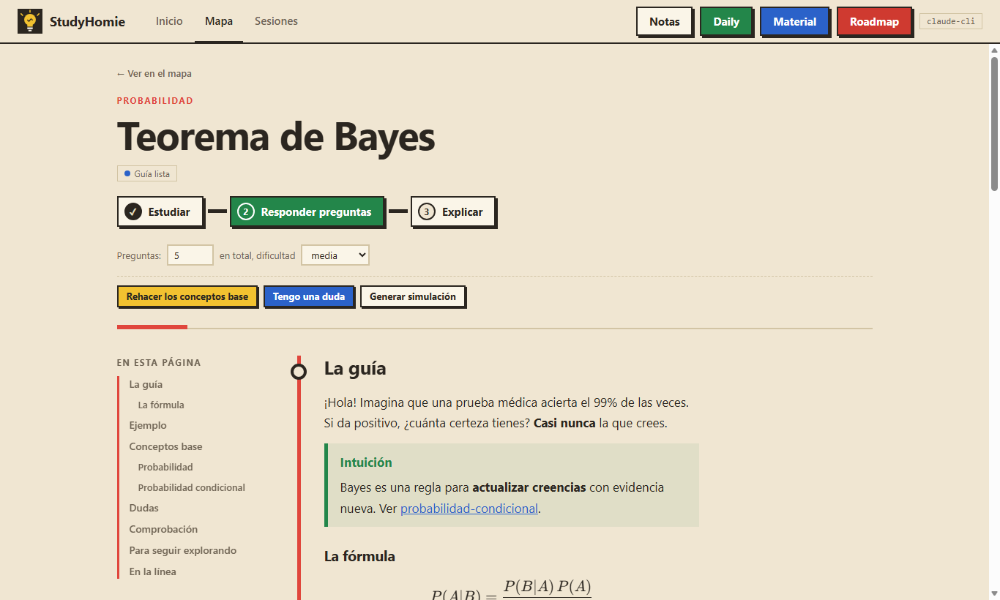

# StudyHomie

**Aprende con intuición y comprueba que puedes explicarlo.**
Un asistente de estudio con IA que corre en tu computadora, con una interfaz web local y un vault de notas Markdown (compatible con Obsidian) que muestra lo que has aprendido y cómo se conecta.



## Qué hace

Puedes empezar de tres maneras, y todas llevan al mismo ciclo de estudio:

| Entrada | Qué hace |
|---|---|
| **Roadmap** | Te pregunta tu objetivo y nivel, y traza un grafo de temas con prerrequisitos y conexiones, al estilo Obsidian. |
| **Material** | Estudias desde tus propios apuntes: txt, md, pdf, pptx, docx o imágenes. |
| **Daily** | Un tema aleatorio de los campos que elijas (filosofía, historia, historia del arte, física, medicina, informática…), para aprenderlo en un día. Puedes sortear entre tus intereses, entre todos los campos, o escribir un campo nuevo. |

Cada tema pasa por **tres fases**:

1. **Estudiar.** La IA busca material en línea y escribe una guía imparcial que construye intuición. Los recursos externos (videos de YouTube, webs, libros, papers) van **siempre con su enlace**, y los enlaces se comprueban antes de guardarlos. Si el tema lo pide, genera una simulación interactiva.
2. **Responder preguntas.** Un test de la longitud y dificultad que elijas.
3. **Explicar** (método Feynman). Le explicas el tema a la IA como si no supiera nada, y te señala los huecos, errores y saltos que encuentra.

Y hay dos extras opcionales, que se hacen dentro del propio artículo y no cambian tu avance:

- **Extender, conceptos base.** Si la guía da por sabido algo que no dominas (la paradoja del cumpleaños pide algo de probabilidad), el botón añade al artículo una sección que lo explica desde cero, en pocas líneas y con ejemplos pequeños. No se genera por defecto.
- **Dudas.** Un apartado al final de la guía donde preguntas como en un chat (por ejemplo, «entiendo qué es una probabilidad, pero no por qué se multiplican»). La respuesta tiene en cuenta lo que ya preguntaste, y tu duda con su respuesta se guardan en el artículo. Si en la respuesta se explica un concepto que da para un tema propio, te ofrece añadirlo al vault como artículo, ya conectado con el original.



## Requisitos

- Un navegador.
- **Una de estas dos** formas de acceder a un modelo de IA:
  - [Claude Code](https://claude.com/claude-code) instalado y con sesión iniciada (usa tu propio plan), **o**
  - una clave de la [API de Anthropic](https://console.anthropic.com/) (se paga por uso).

## Instalación

**Opción A: binario listo (sin instalar nada más).** Descarga el archivo de tu sistema desde [Releases](https://github.com/krilinxito/studyhomie/releases/latest), descomprímelo y deja `studyhomie` (o `studyhomie.exe` en Windows) donde quieras, idealmente en una carpeta que esté en tu `PATH`.

**Opción B: con Go** (1.24 o superior):

```
go install github.com/krilinxito/studyhomie/cmd/studyhomie@latest
```

**Opción C: desde el código:**

```
git clone https://github.com/krilinxito/studyhomie
cd studyhomie
go build -o studyhomie ./cmd/studyhomie
```

## Uso normal

1. **Crea una carpeta para tus estudios** y entra en ella. Ahí vivirá tu vault.

   ```
   mkdir mis-estudios
   cd mis-estudios
   ```

2. **Ejecuta `studyhomie`.** Sin argumentos abre la interfaz web en <http://127.0.0.1:8765> y crea la carpeta `vault/` la primera vez.

   ```
   studyhomie
   ```

3. **Empieza a estudiar desde el navegador:** con «Nuevo estudio» escribe un tema, traza un roadmap o sube tus apuntes, o sortea el reto del día en Inicio. Las sesiones corren en vivo; solo tienes que ir respondiendo.

Para parar el programa, `Ctrl+C` en la terminal. Cada carpeta es un vault independiente: puedes tener una por materia, o una sola para todo.

> Si al arrancar ves un aviso rojo, falta configurar la IA (ver la siguiente sección).

## Interfaz

Todo se navega desde la barra superior: **Inicio** (el reto de hoy, tus líneas y lo que dejaste a medias), **Mapa** y **Sesiones**. **Nuevo estudio** abre un cuadro para empezar con un tema, una materia o tus apuntes, y **Notas** abre un cajón con todas tus notas agrupadas por línea.

- **El mapa es un plano de metro.** Cada roadmap es una línea de color y cada tema una estación: vacía si aún no lo exploras, medio llena con la guía lista, llena si ya lo comprobaste y con anillo cuando lo explicaste.
- **Cada nota es una página de lectura**, con índice lateral, la guía como artículo, los recursos al final y los temas que vienen antes y después en la línea. Arriba tiene los tres pasos en orden (Estudiar, Responder preguntas, Explicar): el siguiente aparece resaltado y los ya hechos se pueden repetir. Junto a ellos están «Extender: conceptos base», «Tengo una duda» y la simulación.
- **La sesión no es solo texto:** el reto del día aparece como tarjeta, las preguntas con opciones clicables, un indicador de fases (Estudiar → Responder preguntas → Explicar) y el puntaje como medidor. La idea es aprender porque sí: comprobar y explicar sirven para ver lo que ya entiendes, no para aprobar nada.
- **Las sesiones se guardan** en `vault/.studyhomie/sessions/` (un JSON por sesión). En **Sesiones** puedes releerlas, eliminarlas o continuar un tema por su siguiente fase (comprobar, explicar). Una sesión no se reanuda a mitad de un turno: si cierras la aplicación mientras corre, queda marcada como interrumpida, y desde ahí se continúa por fase.

Las guías y notas admiten:

- **Avisos** con la sintaxis de callouts de Obsidian (`> [!info] Definición`, `> [!example]`, `> [!tip]`, `> [!warning]`, `> [!question]`), que también se ven bien en Obsidian.
- **Tablas** y **fórmulas** (`$...$`).
- **Diagramas Mermaid** (` ```mermaid `), dibujados en local; si uno no se puede dibujar, se muestra su código.
- **Recursos en lista**, con tipo y dominio. Los videos de YouTube se reproducen dentro de la nota, pero solo cargan YouTube (`youtube-nocookie.com`) cuando haces clic en reproducir; hasta entonces no hay ninguna petición externa.

## Elegir la IA

Por defecto usa **Claude Code** (`claude-cli`). Para cambiar, ejecuta `studyhomie init` dentro de tu carpeta: crea `studyhomie.toml`, que puedes editar.

| `provider` | Qué usa | Qué necesitas |
|---|---|---|
| `claude-cli` (por defecto) | Tu instalación local de Claude Code, con tu sesión. StudyHomie no lee ni guarda tus credenciales: solo ejecuta el comando `claude`. | Instalar Claude Code y ejecutar `claude` una vez para iniciar sesión. |
| `anthropic-api` | La API de Anthropic con tu clave. | Definir la variable de entorno `ANTHROPIC_API_KEY`. |

Con la API puedes elegir modelo (`model = "claude-sonnet-5-5"`, por ejemplo). Por defecto usa `claude-opus-5-5`; un modelo más pequeño sale más barato.

Definir la clave:

```
# Windows (PowerShell), una vez; abre una terminal nueva después
setx ANTHROPIC_API_KEY "sk-ant-..."

# macOS / Linux
export ANTHROPIC_API_KEY="sk-ant-..."
```

> Revisa los términos de tu plan de Claude antes de compartir o automatizar el uso del CLI. StudyHomie lo ejecuta localmente, con tu sesión, como lo harías tú en la terminal.

## Configuración (`studyhomie.toml`)

Todo es opcional; sin el archivo se usan estos valores.

| Clave | Por defecto | Para qué |
|---|---|---|
| `provider` | `"claude-cli"` | `claude-cli` o `anthropic-api` |
| `model` | vacío | Modelo a usar; vacío = el del proveedor |
| `quick_model` | vacío | Modelo para las respuestas cortas (conceptos base y dudas); vacío = `model`. Poner uno más rápido y barato hace que respondan antes |
| `port` | `8765` | Puerto de la interfaz web |
| `language` | `"español"` | Idioma de guías, pruebas y tutor |
| `vault` | `"vault"` | Carpeta de las notas |
| `interests` | lista amplia | Campos de los que sale el reto diario. "Totalmente aleatorio" suma además los campos por defecto |
| `context_window` / `compact_at` | `200000` / `0.6` | Cuándo se resume una conversación larga para que no se acumule el contexto |

## Tu vault

Las notas son archivos Markdown normales con `[[enlaces]]`. **Abre la carpeta `vault/` con [Obsidian](https://obsidian.md)** y verás el grafo de lo que has aprendido.

```
vault/
  topics/        un .md por tema: guía, recursos, prueba y Feynman, con enlaces entre temas
  roadmaps/      el plan de cada roadmap
  daily/         un registro por día
  interactive/   simulaciones generadas (HTML)
  .studyhomie/   estado interno (resúmenes entre fases, apuntes subidos, sesiones guardadas)
```

## Desde la terminal

Todo lo que hace la interfaz web también se puede hacer sin ella:

```
studyhomie roadmap "Teoría de juegos"     # alcance + grafo de temas
studyhomie material apuntes.pdf           # roadmap desde tus apuntes
studyhomie next teoría-de-juegos          # siguiente tema cuyos prerrequisitos ya dominas
studyhomie daily                          # reto del día (o: daily Física, daily todos)
studyhomie study "Teorema de Bayes"       # preparación → prueba → Feynman
studyhomie prepare | quiz | feynman | extend | interactive <tema>
studyhomie doubt <tema> "tu pregunta"     # responde una duda y la guarda en el artículo
studyhomie graph                          # temas y conexiones
studyhomie serve --port 9000 --no-open    # interfaz web en otro puerto, sin abrir el navegador
studyhomie help
```

## Privacidad y seguridad

- **Qué se envía al modelo:** el tema que estudias, tus respuestas y explicaciones, y los fragmentos de tus apuntes que sean relevantes. Tus notas y tu vault se quedan en tu computadora.
- **La interfaz web solo escucha en `127.0.0.1`.** Rechaza peticiones con un `Host` que no sea local y exige `Origin` propio en todo lo que modifica algo, de modo que otra página abierta en tu navegador no puede usarla. La única página externa que puede incrustar es el reproductor de YouTube, y solo después de que pulses reproducir.
- **Las simulaciones las escribe la IA**, así que se sirven aisladas: sin red, sin acceso a la app ni a tus datos, y se rechazan las que intenten cargar recursos externos.

## Desarrollo

```
go test ./...
```

Estructura: `cmd/studyhomie` (entrada), `internal/session` (las tres fases y los flujos), `internal/provider/*` (backends de IA, intercambiables), `internal/vault` (notas y grafo), `internal/web` (servidor e interfaz), `internal/material` (extracción y búsqueda en apuntes), `internal/roadmap` (validación del grafo).

Para publicar una versión basta con subir una etiqueta (`git tag v0.2.0 && git push --tags`): el workflow de GitHub compila los binarios y crea la release.

## Licencia

[MIT](LICENSE)
