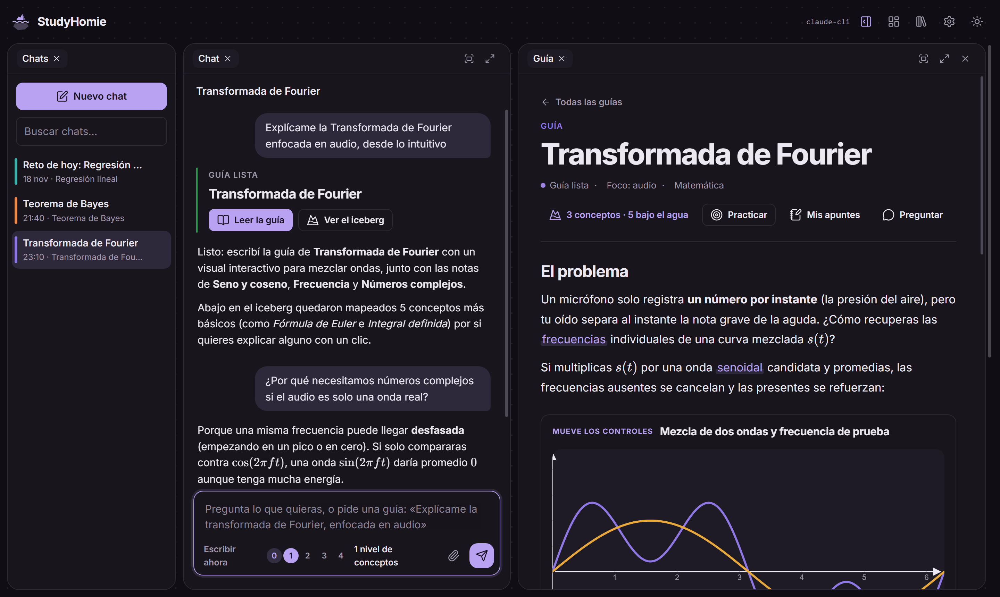
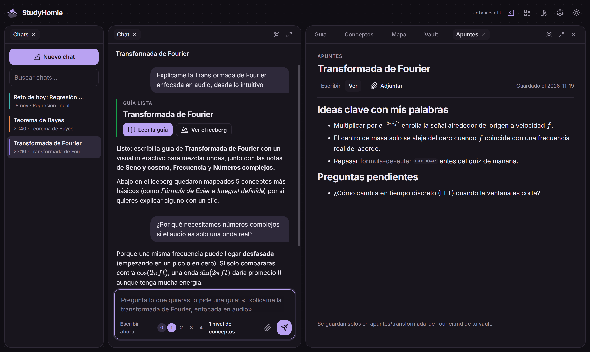
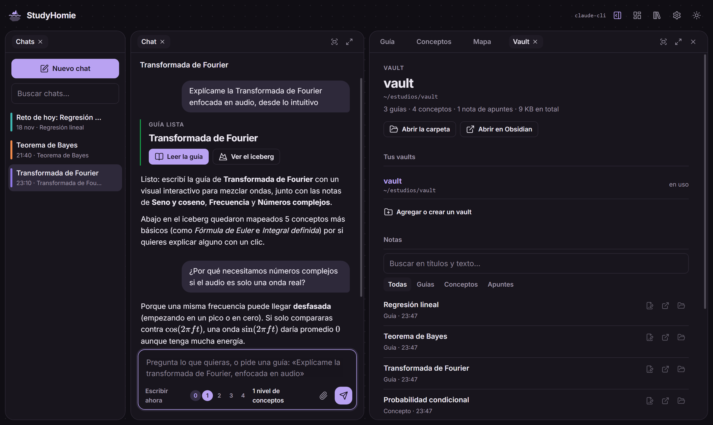

# StudyHomie

**Aprende con intuición y comprueba que puedes explicarlo.**
Un asistente de estudio con IA que corre en tu computadora: un programa de consola con una interfaz web local, y tus notas en un vault de Markdown compatible con Obsidian.

Le preguntas desde un **chat** (con archivos o imágenes adjuntas) y escribe una guía de estudio con visuales interactivos, mapea todo lo que ese tema da por sabido hasta lo básico (un «iceberg» de conceptos), guarda tus propios apuntes en el vault y te hace practicar: preguntas que piden razonar y explicarlo con tus palabras. Funciona con la IA que ya tengas: Claude Code, Codex, Antigravity, cualquier API conocida o un modelo local.



## Instálalo con tu agente de IA

La forma más rápida: abre tu agente de programación (Claude Code, Codex, Cursor, Antigravity…) en una terminal y pégale esto:

```
Instala StudyHomie (https://github.com/krilinxito/studyhomie) siguiendo la sección
«Instalación y puesta en marcha (agentes de IA y consola)» de su README: instala el binario,
configúralo en una carpeta de estudio con la IA que yo ya tenga lista, comprueba que
funciona con `studyhomie check --live` y dime el comando exacto para correrlo desde mi consola.
```

La sección siguiente está escrita como un runbook en orden para que cualquier agente (o tú) pueda instalarlo, verificarlo y correrlo únicamente desde la consola.

## Instalación y puesta en marcha (agentes de IA y consola)

> **Para agentes de IA:** sigue los pasos 1 a 5 en orden; cada uno tiene su verificación.
> - Si `studyhomie version` ya funciona, salta al paso 2.
> - Nunca pidas, escribas ni guardes claves de API en archivos ni en el chat: van siempre en variables de entorno que define la persona.
> - Los inicios de sesión de los CLI (`claude`, `codex login`, `agy`) son interactivos y los hace la persona: si hacen falta, dale el comando exacto y espera su confirmación antes de reintentar.
> - `studyhomie serve` deja un servidor corriendo en primer plano hasta `Ctrl+C`: no lo lances en primer plano si esperas que termine; al acabar el paso 4, entrega a la persona la ruta de la carpeta de estudio, la IA configurada y el comando para correrlo en su consola (o lánzalo en segundo plano con `--no-open` solo si te lo pidió).

### 1. Instala el binario

Decide en este orden:

1. Prueba `studyhomie version`. Si imprime la versión, ya está instalado: pasa al paso 2.
2. Prueba `go version`. Si muestra **1.24 o más**, usa la **opción A**.
3. Si no hay Go, usa la **opción B** (binario de GitHub Releases). Si falla la descarga o necesitas compilar desde una rama concreta, usa la **opción C**.

**A. Con Go (1.24+):**

```sh
go install github.com/krilinxito/studyhomie/cmd/studyhomie@latest
```

El binario queda en `GOPATH/bin`. Si `studyhomie version` no se encuentra después, agrégalo al `PATH`:

```powershell
# Windows (PowerShell)
$gobin = "$(go env GOPATH)\bin"
$userPath = [Environment]::GetEnvironmentVariable('Path', 'User')
if ($userPath -notlike "*$gobin*") { [Environment]::SetEnvironmentVariable('Path', "$userPath;$gobin", 'User') }
$env:Path += ";$gobin"
```

```sh
# macOS / Linux (agrégalo también a ~/.bashrc o ~/.zshrc)
export PATH="$(go env GOPATH)/bin:$PATH"
```

**B. Binario listo, sin Go.**

Windows (PowerShell):

```powershell
$v = (Invoke-RestMethod https://api.github.com/repos/krilinxito/studyhomie/releases/latest).tag_name
$name = "studyhomie_${v}_windows_amd64"
Invoke-WebRequest "https://github.com/krilinxito/studyhomie/releases/download/$v/$name.zip" -OutFile "$env:TEMP\studyhomie.zip"
Expand-Archive "$env:TEMP\studyhomie.zip" -DestinationPath "$env:LOCALAPPDATA\studyhomie" -Force
$dir = "$env:LOCALAPPDATA\studyhomie\$name"
$userPath = [Environment]::GetEnvironmentVariable('Path', 'User')
if ($userPath -notlike "*$dir*") { [Environment]::SetEnvironmentVariable('Path', "$userPath;$dir", 'User') }
$env:Path += ";$dir"   # para esta misma terminal
```

macOS y Linux:

```sh
v=$(curl -fsSL https://api.github.com/repos/krilinxito/studyhomie/releases/latest | grep -m1 '"tag_name"' | cut -d'"' -f4)
os=$(uname -s | tr '[:upper:]' '[:lower:]')
arch=$(uname -m); case "$arch" in x86_64) arch=amd64 ;; aarch64|arm64) arch=arm64 ;; esac
curl -fsSL "https://github.com/krilinxito/studyhomie/releases/download/$v/studyhomie_${v}_${os}_${arch}.tar.gz" | tar -xz -C /tmp
mkdir -p ~/.local/bin && mv "/tmp/studyhomie_${v}_${os}_${arch}/studyhomie" ~/.local/bin/
# si ~/.local/bin no está en el PATH: export PATH="$HOME/.local/bin:$PATH"  (y agrégalo a ~/.bashrc o ~/.zshrc)
```

**C. Desde el código (Go 1.24+):**

```sh
git clone https://github.com/krilinxito/studyhomie
cd studyhomie
go install ./cmd/studyhomie
```

Si prefieres no instalarlo globalmente, compila con `go build -o studyhomie ./cmd/studyhomie` (en Windows `-o studyhomie.exe`) y mueve el binario a una carpeta que esté en el `PATH`.

**Comprueba:** `studyhomie version` imprime la versión y sale con código 0.

### 2. Crea la carpeta de estudio

StudyHomie busca `studyhomie.toml` y tu `vault/` en la **carpeta actual** desde donde lo ejecutes. Usa una carpeta fija (por ejemplo `~/estudios`) y entra en ella:

```powershell
# Windows (PowerShell)
New-Item -ItemType Directory -Force "$HOME\estudios" | Out-Null
Set-Location "$HOME\estudios"
```

```sh
# macOS / Linux
mkdir -p ~/estudios
cd ~/estudios
```

> Todo comando posterior de `studyhomie` debe ejecutarse desde esa carpeta.

### 3. Detecta la IA disponible y crea `studyhomie.toml`

Lista qué IAs puede usar ya esta computadora:

```sh
studyhomie check
```

> **Nota para agentes:** antes de ejecutar `init`, `studyhomie check` puede salir con código **1** si la IA por defecto (`claude-cli`) no está instalada; igualmente imprime la lista completa de IAs disponibles. Lee la salida y no lo trates como un error fatal todavía.

Elige la primera opción que aparezca como **`lista`**, en este orden de preferencia:

1. `claude-cli` — Claude Code con el plan de Claude (la más probada).
2. `codex` — Codex CLI con la cuenta de ChatGPT.
3. Una API con clave ya definida (`anthropic-api`, `openai`, `gemini`, `openrouter`, `groq`, `deepseek`, `mistral`, `xai`, `together`).
4. `ollama` o `lmstudio` — un modelo local ya corriendo.
5. `agy` — Antigravity CLI (experimental).

Crea `studyhomie.toml` y el vault en una sola línea, sin preguntas interactivas:

```sh
# CLI o anthropic-api (no necesitan --model)
studyhomie init --provider claude-cli
studyhomie init --provider codex
studyhomie init --provider anthropic-api

# APIs (necesitan --model)
studyhomie init --provider openai --model gpt-5.2
studyhomie init --provider gemini --model gemini-3-flash
studyhomie init --provider openrouter --model google/gemini-3-flash

# Modelo local (en Ollama, revisa antes los descargados con `ollama list`)
studyhomie init --provider ollama --model qwen3:14b

# Servidor compatible con OpenAI (la clave en OPENAI_COMPAT_API_KEY es opcional)
studyhomie init --provider openai-compatible --base-url http://localhost:8000/v1 --model mi-modelo
```

Salvo los CLI (`claude-cli`, `codex`, `agy`) y `anthropic-api`, las demás IAs necesitan `--model`. Si usas `ollama`, ejecuta `ollama list` para elegir un modelo que la persona ya tenga descargado (o descárgalo con `ollama pull qwen3:14b`). También puedes cambiar el modelo luego en **Ajustes** dentro de la interfaz web.

`init` es idempotente: sobre un `studyhomie.toml` que ya existe, actualiza solo los flags que le pases y conserva el resto.

Si **ninguna** IA sale `lista`, la persona tiene que preparar una. Dale el comando de su caso y espera:

| Quiere usar | Qué hace la persona |
|---|---|
| Claude Code (su plan de Claude) | Windows: `irm https://claude.ai/install.ps1 \| iex`; macOS/Linux: `curl -fsSL https://claude.ai/install.sh \| bash`. Luego ejecuta `claude` una vez para iniciar sesión |
| Codex (su cuenta de ChatGPT) | `npm install -g @openai/codex` y `codex login` |
| Una API | Define la clave en una variable de entorno (ver [Elegir la IA](#elegir-la-ia)) y abre una terminal nueva |
| Un modelo local | Instala [Ollama](https://ollama.com), ejecuta `ollama pull qwen3:14b` y deja Ollama abierto |

**Comprueba:** `studyhomie check` sale ahora con código **0**.

### 4. Comprueba que la IA responde de verdad

```sh
studyhomie check --live
```

Le manda un mensaje corto de prueba a la IA elegida. Si todo funciona, imprime `Funciona: … respondió "listo" en N s.` y sale con código **0**. Si falla, explica el motivo y sale con **1**.

**Si `check --live` falla:**

| Qué pasó | Qué hacer |
|---|---|
| CLI instalado (`claude`, `codex`, `agy`), pero falla al autenticar | Pide a la persona que ejecute `claude`, `codex login` o `agy` en su terminal para iniciar sesión y repite `studyhomie check --live` |
| Dice que falta un modelo o el modelo no existe | Reejecuta `studyhomie init --model <otro-modelo>` (para Ollama, consulta `ollama list`) |
| `ollama` o `lmstudio` dice `no responde` | Pide a la persona que abra Ollama / LM Studio (o ejecuta `ollama serve`) y verifica que tenga al menos un modelo descargado |
| Error de clave o saldo en una API | Pide a la persona que verifique su variable de entorno (sin pegarla en el chat) o cambia de proveedor con `studyhomie init --provider ...` |

### 5. Córrelo desde la consola

Siempre dentro de tu carpeta de estudio (`cd ~/estudios`), puedes usarlo de dos maneras:

**A. Abrir la interfaz web local:**

```sh
studyhomie
```

Abre <http://127.0.0.1:8765> en tu navegador (`Ctrl+C` la cierra). Si el puerto está ocupado usa `studyhomie serve --port 8766`, y si no quieres que abra el navegador automáticamente (por ejemplo, si lo lanza un agente en segundo plano) usa `studyhomie serve --no-open`.

**B. Estudiar directo desde la consola (sin navegador):**

```sh
studyhomie prepare "Teorema de Bayes"                                        # genera la guía sin pedir confirmación
echo s | studyhomie guide "Transformada de Fourier" --depth 1 --foco "audio" # guía + notas de concepto
studyhomie doubt teorema-de-bayes "¿qué pasa si el prior es cero?"           # responde una duda y la guarda en la guía
studyhomie study "Teorema de Bayes"                                          # ciclo interactivo: guía, quiz y Feynman
studyhomie graph                                                             # muestra tus temas y conexiones
```

## Uso desde la consola

Todo lo importante funciona sin abrir el navegador. Los comandos operan sobre el `studyhomie.toml` y el `vault/` de la carpeta actual.

| Comando | Modo | Qué hace |
|---|---|---|
| `studyhomie` / `studyhomie serve [--port N] [--no-open]` | Servidor | Levanta la interfaz web local hasta `Ctrl+C` |
| `studyhomie init [--provider P] [--model M] [--quick-model M] [--base-url URL] [--vault DIR] [--port N]` | Directo | Crea o actualiza `studyhomie.toml` y el vault sin preguntar |
| `studyhomie check [--live]` | Directo | Muestra configuración, vault e IAs listas; `--live` prueba la IA (sale con 0 o 1) |
| `studyhomie prepare "tema"` | Directo | Escribe solo la guía del tema |
| `studyhomie guide "tema" [--depth N] [--foco "..."]` | Interactivo (`--depth 0` directo) | Guía + notas de concepto. `--depth` (0 a 4) decide cuántos niveles de prerrequisitos se escriben ya; el resto queda mapeado para explicar después |
| `studyhomie doubt <tema> "pregunta"` | Directo | Responde una duda sobre una guía y la guarda en ella |
| `studyhomie extend <tema>` | Directo | Agrega los conceptos base que la guía da por sabidos |
| `studyhomie interactive <tema>` | Directo | Genera una simulación interactiva (HTML) en `vault/interactive/` |
| `studyhomie graph` | Directo | Imprime temas y conexiones del vault en texto |
| `studyhomie study "tema"` | Interactivo | Ciclo completo en terminal: guía, preguntas y explicarlo con tus palabras |
| `studyhomie quiz <tema> [n] [dificultad]` | Interactivo | Preguntas de razonamiento sobre una guía |
| `studyhomie feynman <tema>` | Interactivo | Lo explicas tú y te señala los huecos |
| `studyhomie roadmap "materia"` | Interactivo | Pregunta el alcance y qué tanto abarcar, traza la ruta numerada de temas y escribe la guía del tema 1 |
| `studyhomie material apuntes.pdf ...` | Interactivo | Roadmap a partir de tus apuntes (txt, md, pdf, pptx, docx, imágenes) |
| `studyhomie next <roadmap>` | Interactivo | El tema en el que vas: su guía (si falta), la prueba y Feynman; al aprobarlo se escribe la guía del siguiente |
| `studyhomie daily [campo\|todos]` | Interactivo | Propone el reto del día, de tus campos de interés o del que digas |
| `studyhomie help` / `version` | Directo | Ayuda y versión |
| `studyhomie update [--check] [-y]` | Interactivo | Busca una versión nueva y pregunta antes de instalarla (`--check` solo avisa; `-y` no pregunta) |

Los comandos marcados como **Directo** terminan solos sin esperar entrada por teclado (ideales para scripts o para que los ejecute un agente). Los temas se nombran por su slug (`transformada-de-fourier`) o con su título entre comillas.

Los comandos **Interactivos** leen de la entrada estándar (`stdin`), así que también se pueden automatizar por tubería:

```sh
echo s | studyhomie guide "Transformada de Fourier" --depth 1 --foco "audio"   # aprueba el plan tal cual
echo g | studyhomie guide "Teorema de Bayes"                                   # solo la guía, sin notas
studyhomie guide "Teorema de Bayes" --depth 0                                  # solo la guía + iceberg mapeado, sin pausa
```

En el plan de `guide`, `s` (o Enter) lo aprueba, `g` escribe solo la guía, `n` cancela, y se puede editar antes de aprobar: `-id` quita un concepto, `+Título` agrega uno y `*id` escribe ya uno de los de abajo.

## Qué hace

- **Un iceberg de conceptos.** Cada guía mapea todo lo que da por sabido, nivel por nivel, hasta lo básico. Mapear es barato: solo títulos y una frase. «Escribir ahora» (0 a 4) decide cuántos niveles se escriben de entrada como notas; lo de más abajo queda en gris y se escribe con un clic en **Explicar** solo si lo necesitas.
- **Nada se da por sabido en silencio.** La guía enlaza cada término que asume. Si ese concepto aún no tiene nota, el enlace sale en gris con «explicar».
- **Plan editable.** Antes de escribir te muestra el árbol: desmarcas lo que ya sabes, agregas lo que falte, y decides si escribe guía y notas, solo la guía, o nada.
- **Intuición sin plantillas.** Nada de «imagina que tienes…». Las guías arrancan con un problema concreto con números, reinventan la idea (el intento ingenuo, por qué falla y el arreglo), la llevan a los casos extremos y dejan la fórmula para el final.
- **Visuales para mover, al estilo 3Blue1Brown.** Funciones con sliders, una matriz que deforma el plano, procesos paso a paso, experimentos aleatorios repetidos mil veces y preguntas de «predice antes de seguir leyendo».
- **Roadmaps en orden.** Para una materia entera traza una ruta numerada de temas: enfocada en la materia, con sus bases (Ciberseguridad → Linux, Redes…) o desde cero. Solo escribe la guía del tema 1; cada tema siguiente se desbloquea, y se escribe su guía, cuando sacas la nota mínima (70 por defecto, editable en Ajustes) en el anterior.
- **Practicar.** Preguntas de razonamiento, explicar con tus palabras (método Feynman) y tarjetas de repaso.
- **Recursos verificados.** Videos, webs, libros y papers con su enlace; los enlaces se comprueban antes de guardarlos (con las IAs que buscan en la web).

## La interfaz web

Minimal, sobre un fondo de puntos, en claro u oscuro. Todo son paneles acoplables, y el diseño se recuerda. Para no moverlos por accidente están fijos: en el menú de paneles, **Editar diseño** permite arrastrar una pestaña para dividir la pantalla o apilarla, y **Listo** los vuelve a fijar.

- **Conversaciones y Chat.** Preguntas, pides guías, quizzes, el reto del día (con la temática que quieras) o una nota de concepto. Puedes adjuntar imágenes y archivos a un mensaje y la IA los mira con tu pregunta. Las conversaciones se guardan y se pueden continuar.
- **El panel de estudio** entra desde la derecha cuando hay algo que mostrar, y se puede ampliar, poner en pantalla completa o cerrar:
  - **Guía**: el artículo con sus visuales.
  - **Conceptos**: el iceberg; lo de abajo se explica con un clic.
  - **Mapa**: guías y conceptos conectados, de esta conversación o de todas.
  - **Practicar**.
  - **Apuntes**: tus propias notas por guía o concepto, con imágenes y archivos pegados.
- **Vault.** Todas las notas, con búsqueda en el texto. Cada una se abre en la app, se edita a mano o se abre en Obsidian. Desde aquí también se crean otros vaults en cualquier carpeta y se cambia entre ellos; cada uno tiene sus guías, conversaciones y mapa.
- **Ajustes.** Eliges la IA y el modelo de una lista, y pruebas la conexión.






## Elegir la IA

Se cambia con `studyhomie init --provider …` o en **Ajustes** dentro de la app; se guarda en `studyhomie.toml`.

**Con tu suscripción (programas de terminal).** StudyHomie solo ejecuta el comando; no lee ni guarda tus credenciales.

| `provider` | Qué usa | Qué necesitas |
|---|---|---|
| `claude-cli` (por defecto) | Claude Code, con tu plan de Claude | Instalarlo y ejecutar `claude` una vez para iniciar sesión |
| `codex` | Codex CLI, con tu cuenta de ChatGPT o una clave de OpenAI | `npm install -g @openai/codex` y `codex login` |
| `agy` (experimental) | Antigravity CLI, con tu cuenta de Google | Ejecutar `agy` una vez para iniciar sesión |

Codex y Antigravity son agentes con herramientas propias: StudyHomie los ejecuta en una carpeta temporal vacía y les pide solo responder, así nunca tocan tus archivos.

**APIs (clave propia, pago por uso).** La clave va siempre en una variable de entorno, nunca en la app ni en archivos.

| `provider` | Variable | Búsqueda web |
|---|---|---|
| `anthropic-api` | `ANTHROPIC_API_KEY` | sí |
| `openai` | `OPENAI_API_KEY` | sí |
| `gemini` | `GEMINI_API_KEY` (o `GOOGLE_API_KEY`) | sí (Google Search) |
| `openrouter` | `OPENROUTER_API_KEY` | sí |
| `groq`, `deepseek`, `mistral`, `xai`, `together` | `GROQ_API_KEY`, `DEEPSEEK_API_KEY`, … | no |
| `openai-compatible` | `OPENAI_COMPAT_API_KEY` (si hace falta) + `--base-url` | no |

**En tu PC.** `ollama` (`http://localhost:11434/v1`) y `lmstudio` (`http://localhost:1234/v1`), sin clave; la URL se cambia con `--base-url`. Los modelos de 14B o más siguen mejor el formato de las guías.

Sin búsqueda web las guías salen sin videos ni webs recomendados; lo demás funciona igual. `quick_model` es opcional: un modelo más rápido para el chat, las notas de concepto y el plan.

Definir una clave (la persona, una vez):

```sh
# Windows (PowerShell); después abre una terminal nueva
setx OPENAI_API_KEY "sk-..."

# macOS / Linux: agrégalo a ~/.bashrc o ~/.zshrc
export OPENAI_API_KEY="sk-..."
```

> Revisa los términos de cada servicio antes de automatizar el uso de su CLI. StudyHomie los ejecuta localmente, con tu sesión, como lo harías tú en la terminal.

## Configuración (`studyhomie.toml`)

Todo es opcional; sin el archivo se usan estos valores. `studyhomie init` lo crea, y sus flags cambian las claves principales.

| Clave | Por defecto | Para qué |
|---|---|---|
| `provider` | `"claude-cli"` | La IA (ver [Elegir la IA](#elegir-la-ia)) |
| `model` | vacío | Modelo; vacío = el del proveedor |
| `quick_model` | vacío | Modelo para respuestas cortas; vacío = `model` |
| `base_url` | vacío | URL de un servidor local o compatible con OpenAI |
| `port` | `8765` | Puerto de la interfaz web |
| `language` | vacío | Idioma de la interfaz y de lo que escribe la IA: `es`, `en`, `fr`, `zh` o `pt` (también se cambia en Ajustes). Vacío: la primera vez se toma el del navegador. Otro nombre de idioma («Deutsch») hace que la IA escriba en él y la interfaz quede en inglés |
| `vault` | `"vault"` | El vault en uso |
| `vaults` | `[]` | Todos los vaults agregados, para cambiar entre ellos |
| `interests` | lista amplia | Campos de los que sale el reto diario |
| `depth` | `1` | Niveles de conceptos que se escriben de entrada fuera del chat |
| `iceberg` | `true` | Mapear siempre los conceptos hasta lo básico |
| `parallel` | `3` | Notas de concepto que se escriben a la vez |
| `context_window` / `compact_at` | `200000` / `0.6` | Cuándo se resume una conversación larga |
| `pass_score` | `70` | Nota (0–100, prueba o Feynman) que necesita un tema de un roadmap para desbloquear el siguiente |
| `updates` | `"ask"` | Versiones nuevas: `"ask"` avisa y pregunta, `"auto"` las instala solas (se usan al reiniciar), `"never"` no busca |

## Actualizaciones

StudyHomie busca versiones nuevas en GitHub Releases al arrancar y cada pocas horas. Si hay una, la interfaz muestra un aviso con **Ver cambios**, **Actualizar** y **Más tarde**; en el modal de cambios también puedes **omitir esa versión** hasta que salga la siguiente. Se configura en **Ajustes → Actualizaciones** (o con `updates` en `studyhomie.toml`).

Al actualizar, la app descarga el archivo de tu sistema, comprueba su sha256 contra el `checksums.txt` de la release, reemplaza su propio binario y se reinicia sola; la pestaña del navegador se recarga cuando la versión nueva responde. Desde la consola: `studyhomie update`.

Si el binario está en una carpeta sin permiso de escritura (p. ej. una carpeta del sistema), la app te lo dice y puedes descargar la versión a mano desde [Releases](https://github.com/krilinxito/studyhomie/releases/latest). Las compilaciones locales (`go build`, versión `dev`) nunca se actualizan solas.

## Tu vault

Las notas son archivos Markdown normales con `[[enlaces]]`: abre la carpeta del vault con [Obsidian](https://obsidian.md) y verás el grafo de lo que aprendiste. Puedes tener varios vaults (uno por materia, o uno en una carpeta sincronizada); quitar uno de la lista nunca borra su carpeta.

```
vault/
  guias/         un .md por tema: guía, recursos, dudas, prueba y Feynman
  conceptos/     un .md por concepto (En una frase, Intuición, Cómo funciona, Ejemplo,
                 Errores comunes, Relacionado); «requiere:» marca los prerrequisitos
  apuntes/       tus apuntes, uno por guía o concepto; nunca se tocan al reescribir una guía
    adjuntos/    las imágenes y archivos pegados en ellos
  roadmaps/      el plan de cada materia
  daily/         un registro por día
  interactive/   simulaciones generadas (HTML)
  .studyhomie/   estado interno: conversaciones guardadas, archivos subidos, resúmenes
```

## Privacidad y seguridad

- **Qué se envía al modelo:** el tema, tus mensajes y respuestas, lo que adjuntes y los fragmentos relevantes de tus apuntes. El vault se queda en tu computadora.
- **La interfaz solo escucha en `127.0.0.1`.** Rechaza peticiones con un `Host` que no sea local y exige `Origin` propio en todo lo que modifica algo, así otra página abierta en tu navegador no puede usarla.
- **Las simulaciones las escribe la IA**, así que se sirven aisladas: sin red y sin acceso a la app ni a tus datos. Los archivos adjuntos que no son imágenes se descargan, nunca se ejecutan en la app.

## Desarrollo

```sh
go test ./...
go vet ./...
```

Estructura:

- `cmd/studyhomie`: la entrada de la consola.
- `internal/session`: los flujos (guía, plan, roadmap, chat, quiz, Feynman, reto del día).
- `internal/roadmap`: valida la ruta de una materia y decide qué tema está desbloqueado.
- `internal/provider/*` e `internal/providers`: las IAs, intercambiables.
- `internal/vault`: notas, conceptos, apuntes y búsqueda.
- `internal/web`: el servidor y la interfaz, embebida en el binario.
- `internal/viz`: valida los visuales interactivos.

### Versiones y commits

Las versiones las arma [Release Please](https://github.com/googleapis/release-please) a partir de los mensajes de commit, así que usa [commits convencionales](https://www.conventionalcommits.org/es/):

| Prefijo | Para qué | En la versión |
|---|---|---|
| `feat: …` | algo nuevo para quien usa la app | sube la versión menor y sale en «Novedades» |
| `fix: …` | un arreglo | sube el parche y sale en «Arreglos» |
| `perf:` / `docs:` / `refactor:` / `test:` / `ci:` / `chore:` | lo demás | no publica nada por sí solo |

Un cambio incompatible lleva `!` (`feat!: …`). Con cada push a `main`, Release Please mantiene abierto un PR «chore(main): release x.y.z» con el `CHANGELOG.md`. **Al mergearlo** se crea la etiqueta y una release en borrador; el workflow corre los tests, compila los binarios de Windows, macOS y Linux, sube `checksums.txt` y recién entonces la publica. Si los tests fallan, la release se queda en borrador y nadie la recibe.

Subir una etiqueta a mano (`git tag v0.3.0 && git push --tags`) sigue funcionando para casos puntuales.

## Licencia

[MIT](LICENSE)
